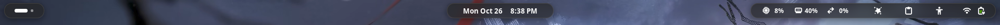

# Islandbar



Turns the GNOME top bar into floating rounded islands: one each for the left,
center and right sections, with the wallpaper showing through the gaps. The
islands are frosted glass over the wallpaper, live wallpapers included, and
they merge into one full-width bar while a window is maximized.

## Features

- Floating islands with a gap from the screen edge. Maximized windows stop
  below them instead of sliding underneath.
- Frosted glass: each island blurs the wallpaper behind it, including video
  wallpapers such as [Hanabi](https://github.com/jeffshee/gnome-ext-hanabi).
- Merges into a full bar while a window is maximized and splits again when it
  isn't. Only colors change, so windows never resize when it happens.
- Accent glow on an island while it's hovered or one of its menus is open.
- Soft drop shadow under each island.
- Dynamic island: the clock island stretches to show the playing song (click
  it to play or pause) and briefly flashes incoming notification titles.
- Optional wallpaper-matched colors from a [matugen](https://github.com/InioX/matugen)
  palette.
- Everything is adjustable in the preferences window: colors, opacity, corner
  radius, gap, border, blur strength and brightness, and each feature on or off.

Defaults follow the Gruvbox dark palette.

## Requirements

- GNOME Shell 50.
- Turn off panel blur in Blur My Shell if you use it, otherwise it draws a
  blurred strip behind the whole bar. Islandbar does its own blur.

## Install from source

```sh
make install
```

Then log out and back in, and enable **Islandbar** in the Extensions app.

## Build a zip

```sh
make pack
```

## Wallpaper colors

Islandbar reads `~/.cache/rice/islandbar.json` when **Match the wallpaper** is
on. To have matugen write it, copy
[`extras/matugen/islandbar.json`](extras/matugen/islandbar.json) to
`~/.config/matugen/templates/` and add to your matugen `config.toml`:

```toml
[templates.islandbar]
input_path  = '~/.config/matugen/templates/islandbar.json'
output_path = '~/.cache/rice/islandbar.json'
```

The islands recolor as soon as matugen rewrites the file.

## License

GPL-2.0-or-later.
